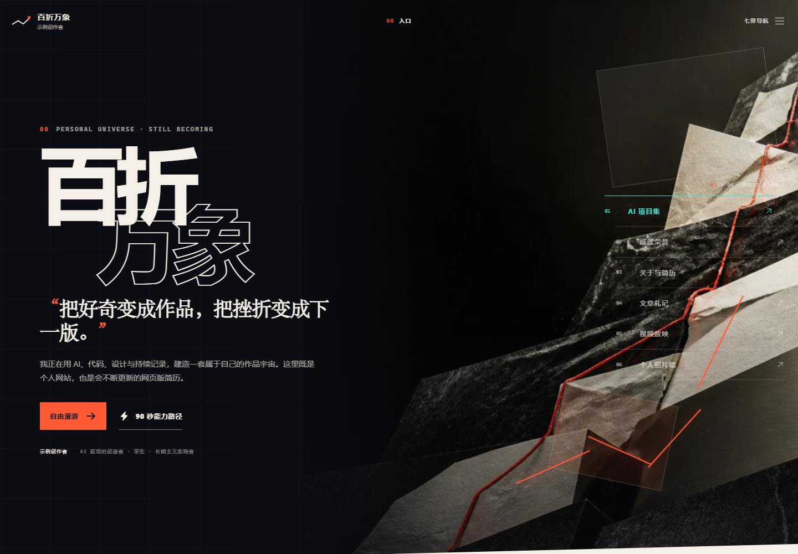

# 开源模板演示

**[打开百折万象模板](https://yangwei251003.github.io/resilience-atlas/)** · [更新记录](CHANGELOG.md) · [素材与协议](ASSET_LICENSES.md) · [本次验证](docs/release-validation.md)



本仓库展示一个七种视觉世界的个人网站模板：Next.js静态导出、React、TypeScript、Motion和Tailwind CSS。**页面中的项目、荣誉、文章、视频与照片仍是清楚标注的示例/AI概念，不是杨炜晨的个人真实履历或这些概念软件的完成证明。** 真实数字简历请查看[GitHub个人主页](https://github.com/yangwei251003)。

最简启动：安装Node.js24与pnpm10.33.2，运行 `pnpm install --frozen-lockfile`，再运行 `pnpm dev`。生产静态站运行 `pnpm build` 后用 `pnpm start` 预览。

GitHub Pages工作流会自动设置 `NEXT_PUBLIC_BASE_PATH` 为仓库子路径，并只上传 `out`。本机如需复现相同子路径，构建前在PowerShell设置 `$env:NEXT_PUBLIC_BASE_PATH='/resilience-atlas'`，然后 `pnpm build`；部署环境变量改变后必须重建。

原创代码和文档使用[MIT](LICENSE)，依赖与AI视觉来源分别见素材说明；不上传真实位置、联系方式、证书、密钥、依赖目录、缓存或私人配置。以下保留原模板的完整运行与内容维护说明。

---
# 百折万象 / RESILIENCE ATLAS

“百折万象”是一座持续生长的个人数字世界，也是一份可以在线浏览的个人简历。

它以“把好奇变成作品，把挫折变成下一版”为核心表达：同一个人、同一条不断向上的韧性线，进入不同页面后会变成完全不同的视觉与交互世界。网站首先服务于自己的感受与长期记录，也希望让老师、同学和朋友看到创造力，让招聘者与合作伙伴快速找到可信的能力证据。

当前版本是可运行的内容与体验骨架。姓名、学校、联系方式、项目、奖项、文章、视频、照片、头像、个人品牌和外部链接仍包含占位内容或 AI 概念素材，不能当作已经核验的真实履历发布。

## 七个页面世界

| 入口 | 页面世界 | 用途与体验 |
| --- | --- | --- |
| `/` | Hero Portal / 入口 | 总入口与个人宣言，通过空间化门户进入其他六个世界。 |
| `/projects/` | AI Lab / AI 项目集 | 展示网站、Skill、小游戏、小程序等 AI 项目，并按问题、选择、结果和复盘组织证据。 |
| `/honors/` | Museum Vault / 成就荣誉 | 用博物馆展柜呈现比赛、奖项和证书；材料未核验前保持空展柜状态。 |
| `/about/` | Swiss CV / 关于与简历 | 在“90 秒证据”和“完整人格”之间切换，承载基础信息、教育经历、能力与联系方式。 |
| `/journal/` | Thought Garden / 文章札记 | 以“火种、淬炼、成章”记录文章、观点、心得与持续变化的思考。 |
| `/videos/` | Cinema / 视频放映 | 为项目演示、比赛复盘、分享和个人介绍视频预留沉浸式放映空间。 |
| `/photos/` | Contact Sheet / 个人照片墙 | 用接触印样与显影体验记录真实照片、时间、地点和个人感悟。 |

项目与文章还各自拥有详情页。新增条目后，网站会根据内容数据生成对应的静态页面。

## 内容从哪里修改

绝大多数需要长期维护的文字和条目都集中在 [`src/content/site.ts`](src/content/site.ts)：

- `identity`：姓名、身份、所在地、公开联系方式和个人宣言；
- `traits`：个人品牌特质；
- `worlds`：七个页面世界的名称、入口和引导语；
- `projects`：AI 项目及其问题、关键选择、结果和复盘；
- `honors`：奖项、荣誉与证据说明；
- `experiences`：教育和实践经历；
- `journalEntries`：文章与观点；
- `videos`：视频席位、海报和章节；
- `photoRolls`：照片组、图片和说明。

日常替换内容时，优先修改这个文件，不需要逐页寻找相同文字。页面结构和动效代码位于 `src/app/`，共享导航与真实性标签位于 `src/components/`。

## 占位与 AI 内容的替换规则

网站使用三种内容状态：

- `placeholder`：明确占位，等待真实资料；
- `ai-generated`：AI 生成的概念文案或视觉示意；
- `final`：真实内容已经核验，可以公开。

替换时请遵守以下规则：

1. 先替换真实内容，再把对应条目的 `provenance` 改为 `final`。不要只改标签。
2. 项目、奖项和经历必须核对名称、时间、本人角色、机构与结果。没有证据时宁可留白。
3. 外部链接、邮箱、社交主页、下载地址和二维码只有在真实可访问后才启用；不要使用虚构链接或 `#` 冒充入口。
4. 头像、个人 IP、品牌标志、视频、照片和作品截图替换后，要同步修改标题、说明和图片替代文字，删除“AI 概念示意”或“待替换”字样。
5. 证书和照片发布前应遮挡编号、住址、证件信息等不宜公开的内容，并确认相关人物允许公开。
6. AI 生成的文章结构不能冒充个人经历。正式发布前应加入真实事件、个人判断、项目证据和自己的表达。

AI 视觉素材集中在 `public/media/`，当前网页实际使用的主要文件为：

- `hero-resilience-atlas-ai.webp`：首页主视觉；
- `cinema-portal-ai.webp`：视频世界概念海报；
- `contact-sheet-ai.webp`：照片墙概念接触印样。

文件名中的 `-ai` 是来源提醒。对应 JPG 源文件保存在 `assets/source-media/`，不会进入静态发布目录；执行 `pnpm media:optimize` 可重新生成 WebP。替换真实素材时可以保留同名文件以免改代码，也可以在 [`src/content/site.ts`](src/content/site.ts) 或对应组件中更新路径。`public/` 中的每个文件都会随静态网站一起发布，不准备展示的原始大图不应长期留在这里。

## 本地打开网站

电脑需要安装 Node.js 和 pnpm。第一次打开项目时运行：

```powershell
pnpm install
pnpm dev
```

随后在浏览器访问 [http://localhost:3000](http://localhost:3000)。开发模式会在保存文件后自动刷新页面。

提交或发布前运行完整检查：

```powershell
pnpm check
pnpm qa:browser
pnpm qa:flows
```

`pnpm check` 会依次检查类型、代码规范并生成静态网站；两个 `qa` 命令会在静态预览已经启动时，分别检查九条页面路由与关键交互旅程。

## 生成并预览静态网站

本项目不依赖常驻服务器。生成静态文件后，动画、拖拽、筛选和页面交互仍会在浏览器中运行，并不是一组静态截图。

```powershell
pnpm build
pnpm start
```

`pnpm build` 会把最终文件生成到 `out/`，`pnpm start` 会在 [http://localhost:3000](http://localhost:3000) 预览这个目录。停止预览可在终端按 `Ctrl + C`。

Next.js 16.3.3 在 Windows 静态导出中存在已报告的 RSC 请求路径问题（[vercel/next.js#85374](https://github.com/vercel/next.js/issues/85374)）。构建命令已接入 `scripts/fix-next-static-rsc.mjs`：它只为受影响的文件生成兼容副本，保留原文件、支持重复执行，并在内容冲突时拒绝覆盖。发布时不要跳过项目内的 `pnpm build` 而直接调用 `next build`。

部署到任意静态托管平台时，可使用：

- 构建命令：`pnpm build`
- 发布目录：`out`

也可以在本地生成后，直接上传 `out/` 目录中的内容。

生产托管建议为 `/_next/static/` 与 `/media/` 设置长期缓存；带内容哈希的 Next.js 静态资源可使用 `Cache-Control: public, max-age=31536000, immutable`。真实照片或同名替换素材如果会原地更新，应使用较短缓存或更新文件名，避免访客长期看到旧版本。

## 正式上线开关

网站通过 `NEXT_PUBLIC_SITE_READY` 控制是否允许搜索引擎收录：

- 未设置或不是 `true`：默认 `noindex, nofollow`，适合当前占位阶段；
- 设置为 `true`：允许搜索引擎收录，适合真实资料已完成并检查通过的正式版本。

这是一个构建期开关。静态网站生成以后再修改托管环境变量不会生效，必须设置变量后重新构建。例如在 PowerShell 中：

```powershell
$env:NEXT_PUBLIC_SITE_READY="true"
pnpm build
```

在 Vercel、EdgeOne、Cloudflare Pages 等平台上，则在项目环境变量中添加 `NEXT_PUBLIC_SITE_READY=true`，再触发一次全新构建。

只有在姓名、联系方式、项目链接、奖项证据、隐私处理、AI 标签和全部页面都检查完成后，才应打开这个开关。它只控制搜索引擎指令，不会替你验证内容真实性。

## 动效与空间体验

当前实现使用 Motion、CSS 3D、滚动联动、指针与触摸交互来建立空间感，没有引入 Three.js 等重型 3D 引擎。这样可以保持清晰的代码结构和静态部署能力，同时继续保留完整的动态体验。

移动端不是“轻量版”：视觉层级、内容和标志性交互都应保留，只根据触摸、滑动和屏幕尺寸改变输入方式与排版。后续优化也应优先使用变换与透明度等高性能动画方式，不以关闭动效作为默认体验。

## 当前发布前检查清单

- [ ] 替换姓名、学校、经历和联系方式；
- [ ] 接入真实项目、链接、角色与结果证据；
- [ ] 接入奖项材料并完成隐私遮挡；
- [ ] 替换头像、个人 IP、品牌视觉和 AI 概念图片；
- [ ] 替换或重写 AI 文章结构；
- [ ] 接入真实视频、海报、照片和感悟；
- [ ] 检查桌面、手机、键盘与触摸体验；
- [ ] 运行 `pnpm check` 并完成浏览器验收；
- [ ] 最后设置 `NEXT_PUBLIC_SITE_READY=true` 并重新构建。
